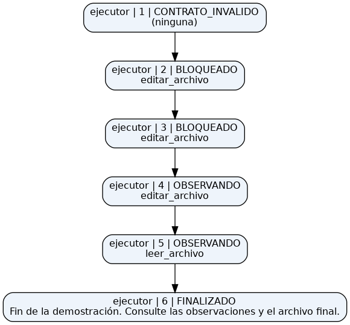
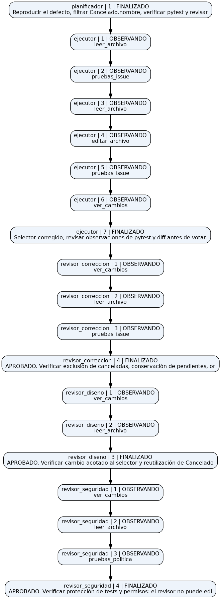

# E7. Observación del sistema agéntico — EcoRecicla AQP

Las primeras tres filas provienen de las trazas originales del equipo. Las corridas nuevas
usan decisiones grabadas escritas por Codex y ejecutan herramientas reales en copias temporales.
Las aprobaciones de las evidencias nuevas son simuladas y se identifican en resultado.json.
No se hicieron llamadas a un proveedor LLM ni se midieron tokens o costo monetario.

## Métricas reproducibles

| Ejecución | Decisiones (incl. final) | Acciones | Rondas | Contrato inválido | Bloqueos | Límite | Contexto registrado (car.) | Tiempo (s) |
|---|---:|---:|---:|---:|---:|---:|---:|---:|
| Issue 01 · E2 histórico | 8 | 7 | 1 | 0 | 0 | 0 | 2994 | 257.322 |
| Issue 03 · E4 histórico | 12 | 11 | 1 | 0 | 0 | 0 | 4328 | 185.938 |
| Issue 02 · E5 actor-crítico histórico | 16 | 13 | 1 | 0 | 0 | 0 | 5599 | 283.62 |
| E6 · simulación de aprobación | 6 | 5 | 1 | 1 | 2 | 0 | 262 | 0.0 |
| Issue 02 · reto uno (grabado) | 12 | 9 | 1 | 0 | 0 | 0 | 3424 | 0.464 |
| Issue 02 · reto tres (grabado) | 19 | 14 | 1 | 0 | 0 | 0 | 5505 | 0.664 |

## Definiciones y límites de la comparación

- Una decisión corresponde a un evento accion o final. Las acciones incluyen intentos bloqueados y contratos inválidos; el objetivo inicial no cuenta.
- Las decisiones del actor-crítico se suman por rol; no se confunde el paso local final con los pasos de todo el sistema.
- Rondas significa rondas de ejecución/revisión; para el agente único se registra una ejecución.
- Contexto registrado es la suma de caracteres de observacion, truncada por el núcleo a 600 por evento. No es el contexto completo enviado al modelo (faltan objetivo, decisiones y observaciones completas). Se conserva el criterio empleado por Daniel para compararlo.
- Tiempo: suma de duración final de cada rol por archivo. Incluye espera humana en las trazas históricas y no la incluye en las reproducciones; no permite comparar velocidad de LLM.
- BLOQUEADO, CONTRATO_INVALIDO y LIMITE_ALCANZADO se cuentan por separado.
- El PDF reporta para el Issue 02 con agente único 10 acciones, 3640 caracteres y 158,291 s. Su JSONL no está en este clon; esos valores son referencia documental, no medición recalculada. La comparación controlada nueva sí conserva todas las trazas de uno y tres revisores.
- E2 y E4 resuelven defectos distintos; sus diferencias no aíslan el efecto de la memoria.

## Herramientas por ejecución

- **Issue 01 · E2 histórico**: `editar_archivo`, `ejecutar_comando`, `leer_archivo`.
- **Issue 03 · E4 histórico**: `anotar`, `editar_archivo`, `ejecutar_comando`, `leer_archivo`, `mapa_repo`.
- **Issue 02 · E5 actor-crítico histórico**: `anotar`, `editar_archivo`, `ejecutar_comando`, `ejecutar_pruebas`, `leer_archivo`, `mapa_repo`, `ver_cambios`.
- **E6 · simulación de aprobación**: `editar_archivo`, `leer_archivo`.
- **Issue 02 · reto uno (grabado)**: `editar_archivo`, `leer_archivo`, `pruebas_issue`, `ver_cambios`.
- **Issue 02 · reto tres (grabado)**: `editar_archivo`, `leer_archivo`, `pruebas_issue`, `pruebas_politica`, `ver_cambios`.

## Comparación del reto democrático

Ambas variantes nuevas parten del mismo selector defectuoso, aplican la misma corrección y
verifican la misma aceptación y tres casos adicionales: entrada vacía, todas canceladas,
orden/identidad y conservación de la entrada. En ambos casos la prueba obligatoria pasó.
Un revisor registró 9 acciones y tres revisores 14;
el incremento es 55.6 %.
El contexto registrado pasó de 3424 a 5505 caracteres
(60.8 % más).
La votación del caso de tres revisores fue unánime, 3/3, en una ronda.
El revisor de diseño inspeccionó el alcance y la reutilización del estado; seguridad ejecutó
las pruebas de gobernanza. Ninguno descubrió otro defecto del selector. Los casos adicionales
los escribió Codex al preparar el experimento, no fueron un descubrimiento autónomo de los revisores.
La reproducción muestra el costo de coordinación y el funcionamiento de la mayoría; al provenir
las decisiones de un mismo asistente no demuestra independencia entre tres LLM.
Para este defecto acotado, el revisor único sigue siendo suficiente.

## Incidentes observados

1. Issue 01: pytest detectó 30 puntos en lugar de 20 antes de la corrección.
2. Issue 02 histórico: el ejecutor y el revisor tuvieron PermissionError en pytest; el ejecutor logró otra corrida, pero el revisor aprobó sin una verificación propia completa exitosa. Su aprobación no se presenta como una suite verde independiente.
3. E6: args de tipo texto fue rechazado por contrato; el intento de editar tests fue bloqueado; una edición rechazada no se ejecutó; otra aprobada sí se ejecutó. Las entradas fueron programadas para probar el callback.
4. Los controles de comandos del framework aceptaban prefijos y usaban shell=True. Se quitaron los operadores de shell y la ejecución por shell; se probaron rutas con ../ y variantes de tests/.

## Trayectorias generadas automáticamente

Fuentes editables: trazas/gobernanza_e6.mmd y trazas/democracia.mmd; las imágenes se generan
con Graphviz desde los mismos eventos JSONL. Regeneración: `python -m agentes.consolidar`.
