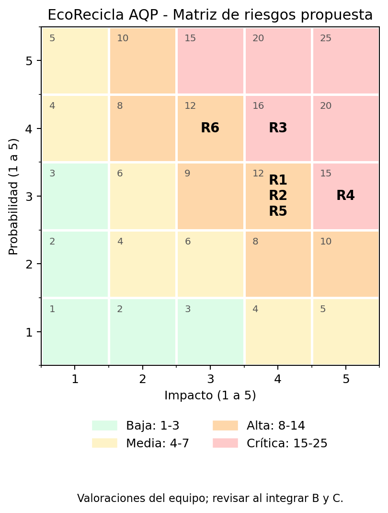

# Evaluación ATAM-lite: EcoRecicla AQP, Lab08

## Alcance y estado

Base revisada: main a4b957a0fa305f901facac1c6c2e081014587c99 y prototipo QA-04 de Persona B.

Evaluación recibida real: [issue #24, Grupo 01](https://github.com/AntonyCondori/cs-2026b-lab04-grupo10/issues/24).
Las respuestas fueron publicadas en el issue #24. El issue permanece abierto para seguimiento y revisión de los pendientes.

Enlace al comentario: https://github.com/AntonyCondori/cs-2026b-lab04-grupo10/issues/24#issuecomment-6552561941

Evaluación emitida: pendiente de confirmar con el docente el repositorio asignado y revisar su árbol de utilidad e iteración 1. El repositorio del Grupo 01 consultado no expone actualmente archivos con esos nombres; no se inventan hallazgos sobre entregables no revisados. Recibir una evaluación del Grupo 01 no prueba por sí solo que sea también el destinatario asignado.

## Respuesta fundamentada a la evaluación recibida

| ID recibido | Respuesta propuesta | Evidencia y alcance |
|---|---|---|
| S1: sensibilidad a mapas | Aceptación parcial | C4 y el esqueleto dominio.py muestran geocodificación; drivers.md, R-06 y RF-04, definen mapas como enlace externo. Existe una contradicción de diseño que Persona A debe resolver. No hay medición de p95 que demuestre la sensibilidad alegada. |
| T1: BD compartida y límites | Aceptado como trade-off de diseño | ADR-001/C4 utilizan un monolito con PostgreSQL compartido. El aislamiento de esquemas exige disciplina; no hay acceso SQL productivo suficiente para probar que ya ocurren JOIN cruzados. |
| R1: reconexión PWA y mapas agotan conexiones, producen HTTP 500 y pérdida | Parcialmente aceptado como riesgo condicionado; se refuta como fallo ya demostrado | No existen pruebas de carga ni evidencia de agotamiento del pool o HTTP 500. Además, la dependencia obligatoria de una API de mapas contradice R-06. La sincronización offline es un escenario propuesto, no una implementación verificada. Se separan esos supuestos antes de adoptar circuit breaker/cola. |
| R2: erosión de límites SQL | Aceptado como riesgo futuro | Una BD compartida no impide accesos cruzados por sí sola. Persona C debe distinguir controles de imports Python de controles SQL; import-linter no analiza consultas ni permisos de PostgreSQL. |
| N1: reglas extensibles | Aceptado con alcance limitado | La iteración 1 verifica un material y una campaña, sin editar la lógica y con regresión. Esto respalda esos ejemplos, no garantiza ausencia de regresiones para cualquier cambio ni seguridad entre distritos. |

## Hallazgos propios

- S2, sensibilidad: la deduplicación depende de que todos los envíos usen el mismo ID/clave y compartan el almacenamiento. Evidencia: restricciones únicas y pruebas de conflictos y recreación del registro.
- T2, trade-off: persistencia/unicidad y transacción frente a espacio y contención. Se midió la reducción de duplicados; el costo de latencia queda como hipótesis sin benchmark.
- R3: sin deduplicación persistente se repite el abono. El prototipo sin táctica produjo 100 abonos; con táctica, 1. La integración real sigue pendiente.
- R4: QA-03 / ADR-008 aporta verificación de aislamiento en memoria: 100 accesos cruzados denegados, 0 filas ajenas y 100 escrituras cruzadas rechazadas. La idempotencia no lo resuelve; falta integración productiva de autorización y persistencia.
- N2: el prototipo protegido conserva el resultado al recrear el registro y revierte confirmación y abono ante fallo intermedio. No equivale a garantizar durabilidad frente a cortes físicos.

## Matriz de probabilidad e impacto

Escala de equipo: 1 a 5; puntuación P x I. Zona crítica propuesta: >= 15; 8-14 alta; 4-7 media; 1-3 baja. No es un umbral impuesto por la guía. Las calificaciones son juicio del equipo, no frecuencias medidas. La evaluación recibida usa categorías cualitativas; los valores siguientes son una normalización propuesta, pendiente de acuerdo.

| ID | Riesgo | P | I | P x I | Tratamiento y estado |
|---|---|---:|---:|---:|---|
| R1 | Dependencia obligatoria de mapas / reconexión offline sin diseño coherente | 3 | 4 | 12 | Resolver contradicción R-06/C4 con Persona A; no afirmar mitigación productiva. |
| R2 | Acceso SQL entre módulos sin controles | 3 | 4 | 12 | Persona C: controles estructurales y propuesta de permisos/SQL; import-linter solo no cubre SQL. |
| R3 | Abonos duplicados por reenvío | 4 | 4 | 16 | Crítico: mitigación probada en QA-04; riesgo productivo abierto hasta integrar en PostgreSQL. |
| R4 | Exposición de datos de otro distrito | 3 | 5 | 15 | Crítico: mitigación verificada en el prototipo de [iteración 3](add/iteracion-3.md) y [ADR-008](adr/008-aislamiento-por-distrito.md), con FF-05 en CI. Abierto para producción hasta integrar autorización y persistencia. |
| R5 | Un solo VPS deja el sistema sin servicio ante caída | 3 | 4 | 12 | Se propone aceptar ausencia de alta disponibilidad en el MVP de un mes; requiere acuerdo, respaldo y recuperación por definir. |
| R6 | C4/ADR y código describen tecnologías y estados diferentes | 4 | 3 | 12 | Alinear Node.js/Python y actualizar métricas de Lab07; pendiente de consolidación. |

## Dependencias para cerrar E3 y E7

1. Confirmar el destinatario y revisar su árbol e iteración 1.
2. Publicar la evaluación emitida con sensibilidad, trade-off, dos riesgos y un no riesgo, todos sustentados.
3. Revisar y publicar la respuesta al issue #24; agregar enlaces a los comentarios reales.
4. Actualizar el estado de R3/R4 con evidencia de las integraciones, sin convertir una simulación en garantía productiva.
5. Completar al menos cinco interacciones reales de IA en la bitácora, incorporando las de A y C.
